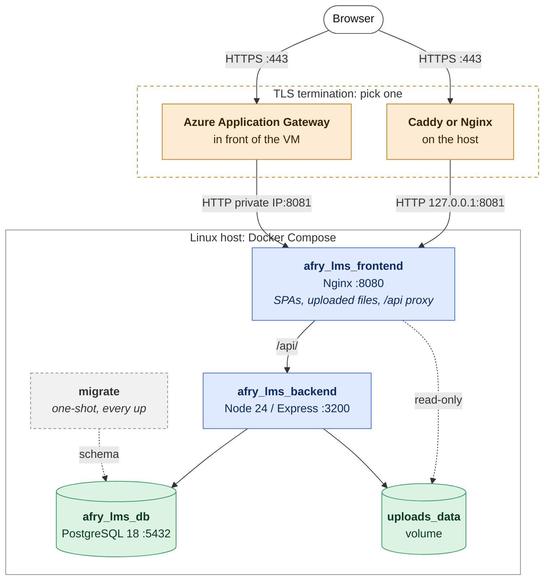

# AFRY LMS — Production Deployment

## Architecture



The three long-running containers and the one-shot `migrate` container are pulled from GitHub Container Registry (GHCR). **No source code or repository access is needed on the server.**

---

## Prerequisites

- Linux server (Ubuntu 26.04 LTS recommended)
- Domain name with an A record pointing to the server IP
- Port 443 open in the firewall (`APP_PORT`, the port the AFRY LMS container binds to, is localhost-only and must not be exposed externally)
- Docker 24+ with the Compose plugin
- `sudo` rights on the server
- The image pull token from the AFRY LMS team (see [step 4](#4-authenticate-with-ghcr)). No GitHub account is needed
- Outbound HTTPS to `github.com` and `*.githubusercontent.com` (release files) and `ghcr.io` (images). The full list, including email, AI and certificates, is in [Server requirements](./server-requirements.md#outbound)
- `curl` and `openssl` (both preinstalled on Ubuntu), plus `gpg` and `rsync` for the [backup scripts](./backup-and-recovery.md)
- A separate data disk, if you follow [Encryption at rest](#encryption-at-rest). Plan it before the first start: moving Docker's data afterwards means migrating the volumes

```bash
# Install Docker
curl -fsSL https://get.docker.com | sh
sudo usermod -aG docker $USER   # re-login after this
```

---

## First-time setup

### 1. Create a working directory

```bash
mkdir -p /srv/afry_lms && cd /srv/afry_lms
```

### 2. Download the release files

The release files are public. No GitHub account and no login are needed. They are published at [github.com/xavier-follet/afry-lms-releases](https://github.com/xavier-follet/afry-lms-releases/releases/latest):

- `docker-compose.yml`
- `env.prod.example`
- `backup.sh`, `restore.sh`, `backup-healthcheck.sh` (place these in `/srv/afry_lms/scripts/` and `chmod +x` — see the [Backup & Recovery runbook](./backup-and-recovery.md))
- `rotate-secret.sh`, in the same directory (see [Rotating secrets](#rotating-secrets))

```bash
BASE=https://github.com/xavier-follet/afry-lms-releases/releases/latest/download
mkdir -p scripts
for f in docker-compose.yml env.prod.example; do curl -fsSLo "$f" "$BASE/$f"; done
for f in backup.sh restore.sh backup-healthcheck.sh rotate-secret.sh; do curl -fsSLo "scripts/$f" "$BASE/$f"; done
chmod +x scripts/*.sh
```

To fetch a specific release instead of the newest, replace `latest/download` with `download/v1.2.3`.

### 3. Configure environment variables

```bash
cp env.prod.example .env
nano .env
```

See [Environment variables](#environment-variables) for the full reference. The minimum required values:

```env
GITHUB_REPOSITORY=xavier-follet/afry-lms
POSTGRES_PASSWORD=<strong random password>
JWT_SECRET=<output of: openssl rand -hex 32>
FILE_TOKEN_SECRET=<output of: openssl rand -hex 32>
SCORM_CONTEXT_SECRET=<output of: openssl rand -hex 32>
CORS_ORIGIN=https://yourdomain.com
# Needed for email or AI. Leave it empty if you use neither, never as the placeholder
SMTP_ENCRYPTION_KEY=<output of: openssl rand -hex 32>
```

> **Upgrading an existing install?** Add `SCORM_CONTEXT_SECRET` to `.env` before running `docker compose up -d` on the new release. Compose stops with an error if it is missing, and nothing on the running stack changes.
>
> The backend also refuses to start on a placeholder, short or malformed secret, or on the default database password. If it keeps restarting after an upgrade, `docker compose logs backend` names the variable. See [Startup checks](#startup-checks). The fix depends on which one it is:
>
> - **`POSTGRES_PASSWORD`** is `secret` or the placeholder: run `scripts/rotate-secret.sh POSTGRES_PASSWORD`. Editing `.env` alone breaks the database connection.
> - **`SMTP_ENCRYPTION_KEY`** is the `CHANGE_ME_64_HEX_CHARS` placeholder: replace it in `.env` with `openssl rand -hex 32`, or empty it if you use neither email nor AI. Nothing can have been stored under the placeholder, so nothing is lost. Do not use the script for this one.
> - **`JWT_SECRET`, `FILE_TOKEN_SECRET` or `SCORM_CONTEXT_SECRET`** is short or the placeholder: run `scripts/rotate-secret.sh <NAME>`. Nobody is signed out.

### 4. Authenticate with GHCR

The images are private. The AFRY LMS team sends you an access token for pulling them. You do not need a GitHub account.

```bash
echo YOUR_TOKEN | docker login ghcr.io -u afry-lms-customer --password-stdin
```

The username is not checked; any non-empty value works. This is a one-time step. Docker stores the credential in `~/.docker/config.json`.

### 5. Pull images and start

```bash
docker compose up -d
```

On first start, PostgreSQL creates an empty database. The `migrate` service then builds the schema by applying every migration in order (starting from `0001_initial_schema.sql`), and the backend starts only after it has finished. There is no seed data: the backend creates the superadmin from `SUPERADMIN_EMAIL` / `SUPERADMIN_PASSWORD` if none exists yet. Every later `docker compose up` runs `migrate` again, which applies only the migrations that are new.

### 6. Verify

```bash
docker compose ps -a                   # postgres, backend, frontend "Up"; migrate "Exited (0)"
curl http://localhost:8081/api/version # → {"app":"v1.2.3","db":"…","externalFonts":"bunny"}
```

The backend's port 3200 is not published to the host, so check it through the frontend on `APP_PORT`. That also proves the Nginx-to-backend proxy works. A `migrate` container with a non-zero exit code means a migration failed, and the backend will not have started: see `docker compose logs migrate`.

---

## Reverse proxy + HTTPS

Options A and B run on the server itself. Option C uses Azure Application Gateway
instead, for a VM in Azure.

Caddy and Nginx both need port 80 for themselves — the HTTP listener, the ACME
HTTP-01 challenge, and the HTTP-to-HTTPS redirect — so `APP_PORT` must be
something other than 80 before you install either. The shipped
`env.prod.example` already defaults to `APP_PORT=8081`; the examples below
match that. If you changed `APP_PORT` in `.env`, update `localhost:8081` in
the examples to match.

Each option below adds exactly one proxy in front of the app, which is what the
default `TRUST_PROXY=2` assumes. If you put another layer in front (a CDN, a cloud
load balancer), raise it. See [Environment variables](#environment-variables).

### Option A — Caddy (recommended)

Caddy handles certificate provisioning automatically.

```bash
sudo apt install -y debian-keyring debian-archive-keyring apt-transport-https curl
curl -1sLf 'https://dl.cloudsmith.io/public/caddy/stable/gpg.key' \
  | sudo gpg --dearmor -o /usr/share/keyrings/caddy-stable-archive-keyring.gpg
curl -1sLf 'https://dl.cloudsmith.io/public/caddy/stable/debian.deb.txt' \
  | sudo tee /etc/apt/sources.list.d/caddy-stable.list
sudo apt update && sudo apt install caddy
```

`/etc/caddy/Caddyfile`:
```
yourdomain.com {
    reverse_proxy localhost:8081
}
```

```bash
sudo systemctl enable --now caddy
```

### Option B — Nginx + Certbot

```bash
sudo apt install -y nginx certbot python3-certbot-nginx
sudo certbot --nginx -d yourdomain.com
```

`/etc/nginx/sites-available/afry_lms`:
```nginx
server {
    listen 80;
    server_name yourdomain.com;
    return 301 https://$host$request_uri;
}

server {
    listen 443 ssl http2;
    server_name yourdomain.com;

    ssl_certificate     /etc/letsencrypt/live/yourdomain.com/fullchain.pem;
    ssl_certificate_key /etc/letsencrypt/live/yourdomain.com/privkey.pem;

    location / {
        proxy_pass              http://localhost:8081;
        proxy_set_header Host   $host;
        proxy_set_header X-Real-IP         $remote_addr;
        proxy_set_header X-Forwarded-For   $proxy_add_x_forwarded_for;
        proxy_set_header X-Forwarded-Proto $scheme;
        client_max_body_size 200M;
    }
}
```

```bash
sudo ln -s /etc/nginx/sites-available/afry_lms /etc/nginx/sites-enabled/
sudo nginx -t && sudo systemctl reload nginx
```

### Option C — Azure Application Gateway

For a VM in Azure. Application Gateway takes Caddy's place: it holds the
certificate, terminates TLS and forwards plain HTTP to the VM over the private
network. Nothing is installed on the VM itself. The VM needs no public IP, and the
domain's DNS record points at the gateway's public IP rather than the VM.

**1. Let the gateway reach the app.** The shipped compose file binds the app to
`127.0.0.1`, which only the VM itself can reach. Add a second binding on the VM's
private IP in an override file, which Compose loads automatically. Do not edit
`docker-compose.yml`: it is replaced with each release.

`/srv/afry_lms/docker-compose.override.yml`:
```yaml
services:
  frontend:
    ports:
      - "10.0.1.4:8081:8080"   # the VM's private IP
```

```bash
docker compose up -d
curl http://10.0.1.4:8081/api/version   # from the VM
```

**2. Restrict it.** In the VM's network security group, allow inbound TCP 8081
from the Application Gateway subnet only.

**3. Configure the gateway** (v2 SKU, in its own subnet of the same VNet):

| Setting | Value | Why |
|---|---|---|
| Listener | HTTPS 443, your certificate | Replaces Caddy |
| Redirect | HTTP 80 to HTTPS 443 | |
| Backend pool | The VM's private IP | |
| Backend settings | HTTP, port 8081, **timeout 120 s** | Default 20 s is too short for SCORM imports and AI calls |
| Override with new host name | **No** (default) | The backend must see your domain |
| Cookie-based affinity | Disabled | Tokens, no server session |
| Health probe | `/api/version`, host = your domain, 200–399 | Checks the backend, not just Nginx |

**If the WAF is enabled**, raise its file upload limit to at least 200 MB (the
largest SCORM and package import), and check its request body size limit:
saving a page in the editor can send a large JSON body. Rich-text HTML and SCORM
runtime traffic are likely to trip OWASP rules, so run the WAF in Detection mode
during the pilot, add exclusions for what it flags, and only then switch to
Prevention.

Keep `TRUST_PROXY=2`. The backend strips the `:port` Application Gateway adds to
the client address on its own. If Azure Front Door sits in front of the gateway,
set `TRUST_PROXY=3`.

**End-to-end TLS.** The setup above sends plain HTTP inside the VNet. If your
policy requires TLS between the gateway and the VM as well, run Caddy or Nginx on
the VM with a certificate the gateway trusts, point the backend settings at it
over HTTPS, and raise `TRUST_PROXY` by one.

---

## Encryption at rest

AFRY LMS stores personally identifiable information (PII) — user names, email addresses, and training progress — in PostgreSQL. The database runs in a Docker container backed by a named volume on the host filesystem. **Unless that host filesystem is encrypted, PII on disk is readable by anyone with physical or root access to the machine.**

Configure LUKS on a dedicated data disk before starting Docker so the database volume lands on encrypted storage.

```bash
sudo apt install -y cryptsetup

# Confirm device name — replace /dev/sdb below with your data disk
lsblk

sudo cryptsetup luksFormat /dev/sdb
sudo cryptsetup luksOpen /dev/sdb afry_lms_data
sudo mkfs.ext4 /dev/mapper/afry_lms_data

sudo mkdir -p /mnt/afry_lms
sudo mount /dev/mapper/afry_lms_data /mnt/afry_lms
```

Point Docker's data directory at the encrypted mount (run this before the first `docker compose up`):

```bash
sudo systemctl stop docker

sudo mkdir -p /mnt/afry_lms/docker
cat <<EOF | sudo tee /etc/docker/daemon.json
{
  "data-root": "/mnt/afry_lms/docker"
}
EOF

sudo systemctl start docker
```

For unattended reboots, add an entry to `/etc/crypttab` and store the passphrase in a keyfile. See the [Ubuntu full-disk encryption guide](https://ubuntu.com/server/docs/full-disk-encryption) for the complete procedure.

---

## Updating the application

Each GitHub Release publishes updated images. To deploy a new version:

```bash
# Pull and restart with the latest images
docker compose pull
docker compose up -d

# Pin to a specific release
APP_VERSION=v1.2.3 docker compose pull
APP_VERSION=v1.2.3 docker compose up -d
```

If the `docker-compose.yml` itself changed in the release, download it again before running the above.

### PostgreSQL major-version upgrades

A release that bumps the `db` image to a new PostgreSQL major version (as happened with
16 to 18) is **not** a plain `pull` + `up`: PostgreSQL's on-disk format is not compatible
across major versions, and the postgres:18+ image also changed where it expects its volume
mounted (`/var/lib/postgresql` as a single mount, not `/var/lib/postgresql/data`) — starting
the new image straight against an existing 16 volume fails to boot rather than silently
corrupting anything, but it does mean downtime until you upgrade the data. Take a full
backup ([backup-and-recovery.md](./backup-and-recovery.md)), then either:

- **`pg_dump`/`pg_restore`** — dump from the old `db` container before switching images,
  bring up the new image against a fresh volume, restore into it; or
- **`pg_upgrade`** — run the old and new `postgres` binaries against the old and new data
  directories per the [upstream image's upgrade notes](https://github.com/docker-library/postgres/issues/37).

Either way, verify the restored data (`docker compose exec postgres psql -U <user> <db> -c '\dt'`)
before removing the old volume.

---

## Resource limits

Each container declares a CPU and memory limit under `deploy.resources.limits` in `docker-compose.yml`. These prevent a single misbehaving request — a large SCORM import, a slow Mistral API response, or heavy image processing via Sharp — from starving the other containers and taking down the whole host.

> **Requires Docker Compose v2** (the `docker compose` plugin). On the legacy `docker-compose` v1 CLI these limits are silently ignored. Verify with `docker compose version`.

The shipped defaults are conservative starting points suitable for a small deployment:

| Container | CPUs | Memory | Override in `.env` |
|---|--:|--:|---|
| `afry_lms_db` | 1.0 | 512M | `POSTGRES_CPUS` · `POSTGRES_MEMORY` |
| `afry_lms_backend` | 1.0 | 512M | `BACKEND_CPUS` · `BACKEND_MEMORY` |
| `afry_lms_frontend` | 0.25 | 64M | `FRONTEND_CPUS` · `FRONTEND_MEMORY` |
| `migrate` | 0.5 | 256M | `MIGRATE_CPUS` · `MIGRATE_MEMORY` |

**Calibrate before relying on them.** Run a representative load — concurrent learners plus a large SCORM import — and watch actual usage:

```bash
docker stats
```

If a container approaches its memory limit it will be OOM-killed (visible as `OOMKilled` in `docker compose ps` / `docker inspect`). Raise the relevant limit and restart.

Override them in `.env` rather than editing `docker-compose.yml`:

```env
BACKEND_MEMORY=1G
BACKEND_CPUS=2.0
POSTGRES_MEMORY=1G
```

Apply changes with `docker compose up -d` (recreates only the affected containers).

---

## Backup & recovery

A complete AFRY LMS backup is **two artifacts kept together**: an encrypted
`pg_dump` of the database **and** an encrypted archive of the uploaded files
(images and SCORM packages). A database-only backup is not recoverable on its own
— the database stores file UUIDs, and SCORM learner state lives only in the
database while the blobs live only in the `uploads_data` volume.

Encrypted daily backups of both, retention, scheduling, the tested restore
procedure, a backup health check, and RTO/RPO targets are documented in the
dedicated [Backup & Recovery runbook](./backup-and-recovery.md). Set up the
passphrase and `/srv/backups` as described there before going live.

---

## Rotating secrets

Every secret in `.env` can be replaced without signing anyone out or losing stored data.
Each step restarts the backend, so expect a few seconds of unavailability per run; pick a
quiet moment. `scripts/rotate-secret.sh` does it for you, and the manual steps are listed
below in case you prefer to do it by hand.

### When to rotate

| Situation | What to rotate |
|---|---|
| Once a year | Every secret in `.env`. Put it in the calendar next to the backup restore test |
| Someone who could read `.env`, the server or a backup leaves | Every secret in `.env`, plus the GHCR token if it was theirs |
| A secret may have leaked | Everything, now. See [If a secret has leaked](#if-a-secret-has-leaked) |
| Your email or AI provider's policy says so | The SMTP password or AI key, in the back office (below) |

Do not schedule password expiry for the people who use the product: current guidance
(NIST SP 800-63B) is to change a user's password when there is a reason to, not on a timer.
Password rules are set in the product, not here.

### How the overlap works

The backend reads each of `JWT_SECRET`, `FILE_TOKEN_SECRET`, `SCORM_CONTEXT_SECRET` and
`SMTP_ENCRYPTION_KEY` together with an optional `<NAME>_PREVIOUS`. It signs and encrypts
with the new value only, but still accepts the previous one. A rotation therefore has two
steps:

1. **Start.** The current value moves to `<NAME>_PREVIOUS` and a new value takes its place.
   Sessions, file links, SCORM launches and stored secrets created under the old value keep
   working.
2. **Finish.** Once nothing signed with the old value is still in use, remove
   `<NAME>_PREVIOUS`. From then on only the new value is accepted.

| Secret | What it protects | Finish after |
|---|---|---|
| `JWT_SECRET` | Sign-in sessions | 7 days (a session lasts at most 7 days) |
| `FILE_TOKEN_SECRET` | Links to private files and documents, HTML package addresses, SCORM package access | 13 hours (an HTML package address lasts up to 13 hours) |
| `SCORM_CONTEXT_SECRET` | Running SCORM launches | 1 hour |
| `SMTP_ENCRYPTION_KEY` | Stored SMTP passwords and AI keys | Straight away, once re-encryption succeeds |

### With the script

Place `rotate-secret.sh` from the release assets in `/srv/afry_lms/scripts/` with the other
scripts. The host needs `openssl` and `curl`. Before you start:

- **Pin `APP_VERSION` in `.env`** to the release you are running. The script recreates the
  backend from whatever `APP_VERSION` says, and `latest` could swap in a newer image without
  its migrations.
- **If your deployment is not in `/srv/afry_lms`**, pass `COMPOSE_DIR` after `sudo`:
  `sudo COMPOSE_DIR=/opt/lms bash scripts/rotate-secret.sh ...`. Set before `sudo`, it is
  dropped. `HEALTH_TIMEOUT` (default 90 seconds) is how long the script waits for the backend.

```bash
cd /srv/afry_lms

# Sign-in sessions: start now, finish in a week
sudo bash scripts/rotate-secret.sh JWT_SECRET
sudo bash scripts/rotate-secret.sh JWT_SECRET --finish

# Same pattern for the two link-signing secrets (finish after 13 hours and 1 hour)
sudo bash scripts/rotate-secret.sh FILE_TOKEN_SECRET
sudo bash scripts/rotate-secret.sh SCORM_CONTEXT_SECRET

# Encryption key: rotates, then re-encrypts every stored SMTP password and AI key
sudo bash scripts/rotate-secret.sh SMTP_ENCRYPTION_KEY
sudo bash scripts/rotate-secret.sh SMTP_ENCRYPTION_KEY --finish

# Database password: changes the role and .env together
sudo bash scripts/rotate-secret.sh POSTGRES_PASSWORD
```

Each run:

- copies `.env` to `.env.bak.<timestamp>` (mode 600) before changing it. The copy holds the
  old secrets, so delete it once you are satisfied.
- recreates the backend container, then restarts the frontend container so its Nginx finds
  the new backend. The database keeps running.
- waits until `/api/version` reports a database version, which means the backend has
  started and reached the database. If it does not within `HEALTH_TIMEOUT`, the script
  restores `.env`, restarts the backend on the old values and tells you where to look.

For `SMTP_ENCRYPTION_KEY`, the script lists any stored secret that neither key can read and
leaves it as it is. That happens if a value was saved under an even older key, or is
damaged. Re-enter it in the back office, then finish the rotation. In this case `.env` is
not restored: both keys stay configured, so nothing stops working in the meantime.

For `POSTGRES_PASSWORD`, the script sends the new password to PostgreSQL over standard input,
so it never shows in a process listing. If the backend cannot connect afterwards, it sets the
role's password back as well as `.env`. If even that fails, it leaves both on the new
password, so they still agree, and tells you. The `postgres` container keeps the old value in its
environment until the next `docker compose up -d`. That is harmless: the image reads it only
when it creates a new, empty database.

### By hand

**For `JWT_SECRET`, `FILE_TOKEN_SECRET`, `SCORM_CONTEXT_SECRET` and `SMTP_ENCRYPTION_KEY`:**

1. In `.env`, add `<NAME>_PREVIOUS=` with the current value, and replace `<NAME>` with the
   output of `openssl rand -hex 32`.
2. Run `docker compose up -d --no-deps backend`, then `docker compose restart frontend`.
3. For `SMTP_ENCRYPTION_KEY` only, run
   `docker compose exec backend node packages/backend/src/db/reencrypt-secrets-cli.js`.
   It reports how many secrets it re-encrypted and exits non-zero if any could not be read.
4. After the wait in the table above, delete the `<NAME>_PREVIOUS` line and repeat step 2.

**For `POSTGRES_PASSWORD`:**

1. Generate a password: `openssl rand -hex 32`.
2. Change the role's password with psql's `\password` command. It prompts without echoing,
   and the password stays out of both your shell history and psql's. Use your
   `POSTGRES_USER` and `POSTGRES_DB` if you changed them:
   ```bash
   docker compose exec postgres psql -U afry_lms -d afry_lms_db
   # afry_lms_db=# \password afry_lms
   ```
3. Put the same value in `POSTGRES_PASSWORD` in `.env`.
4. Run `docker compose up -d --no-deps backend`, then `docker compose restart frontend`.
5. Check that `curl http://localhost:8081/api/version` shows a version in `"db"`. The
   endpoint answers even without a database, with `"db": null`, which means the password
   does not match.

Changing `.env` alone is not enough. PostgreSQL keeps the password it was given when the
volume was first created, so the backend can no longer connect.

### Secrets outside `.env`

| Secret | How to rotate it |
|---|---|
| SMTP password, system-wide | **System > Notifications**, SMTP section. A super-user enters the new password. Change it at the mail provider first |
| SMTP password, per organization | The organization's **Notification Settings**. An organization admin enters it |
| Mistral AI key, system-wide or per organization | **System > AI** or the organization's **AI Settings**. Create the new key at Mistral, choose **Set key**, then **Test key**, then revoke the old one at Mistral |
| GHCR token | Ask the AFRY LMS team for a new token, then run `docker login ghcr.io` again as in [Authenticate with GHCR](#4-authenticate-with-ghcr) |
| Backup passphrase | Write a new one to `/root/.backup-passphrase`. Keep the old passphrase for as long as the backups it encrypted are retained, or they cannot be restored. See the [Backup & Recovery runbook](./backup-and-recovery.md) |
| `SUPERADMIN_PASSWORD` | Used on first start only. Remove it from `.env` after the first sign-in, and change that account's password under **Settings** |

The in-app ones are described for administrators in the manual's *Passwords and secrets*
article, at `/help/administration/passwords-and-secrets`.

### If a secret has leaked

Assume whoever has it can use it, and skip the overlap:

1. Rotate `JWT_SECRET`, `FILE_TOKEN_SECRET` and `SCORM_CONTEXT_SECRET`, and run each one's
   `--finish` straight away. Everyone is signed out, which is the point: a leaked
   `JWT_SECRET` lets anyone mint a session for any user.
2. Rotate `SMTP_ENCRYPTION_KEY` and finish it.
3. If the database or a backup may also have leaked, the stored SMTP passwords and AI keys
   are exposed too. Change them at the providers and enter the new ones in the back office.
4. Rotate `POSTGRES_PASSWORD`.
5. Ask super-users and administrators to change their passwords. An administrator can also
   send a reset email to any active user they manage, from the user's page. A completed
   reset ends every session that user had; changing your own password ends all your other
   sessions.
6. Review the audit trail under **System > Logs** for the period in question.
7. Replace the GHCR token, and start a new backup passphrase for future backups.

### Startup checks

In production, the backend refuses to start, and logs why, when:

- `JWT_SECRET`, `FILE_TOKEN_SECRET` or `SCORM_CONTEXT_SECRET` is missing, shorter than 32
  characters, or still the `CHANGE_ME` placeholder from `env.prod.example`
- `SMTP_ENCRYPTION_KEY` or `SMTP_ENCRYPTION_KEY_PREVIOUS` is set but is not 64 hex characters
- a `<NAME>_PREVIOUS` equals its `<NAME>`, or is set without it
- `POSTGRES_PASSWORD` is `secret` (the development default, which compose substitutes when
  `.env` sets none) or the placeholder

A value counts as the placeholder when it contains `CHANGE_ME`, in any case.

Read the reason with `docker compose logs backend`.

---

## Environment variables

Generate every secret with `openssl rand -hex 32`. Compose refuses to start
while `JWT_SECRET`, `FILE_TOKEN_SECRET` or `SCORM_CONTEXT_SECRET` is missing.

### Required

| Variable | What it is | Example |
|---|---|---|
| `GITHUB_REPOSITORY` | Where the images are pulled from | `acme/afry-lms` |
| `POSTGRES_PASSWORD` | Database password | strong random |
| `JWT_SECRET` | Signs sign-in tokens | secret |
| `FILE_TOKEN_SECRET` | Signs private-file URLs | secret |
| `SCORM_CONTEXT_SECRET` | Signs SCORM launch contexts | secret |
| `CORS_ORIGIN` | The public origin, exactly | `https://yourdomain.com` |
| `PORTAL_BASE_URL` | Base of the links in emails | `https://yourdomain.com` |

### First run only

| Variable | What it is |
|---|---|
| `SUPERADMIN_EMAIL` | The first super-user. Ignored once one exists |
| `SUPERADMIN_PASSWORD` | Their password. Remove it from `.env` after the first login |

### Optional

| Variable | Default | What it does |
|---|---|---|
| `APP_VERSION` | `latest` | Image tag to run. Pin it, e.g. `v1.2.3` |
| `APP_PORT` | `8081` | Host port of the app, on `127.0.0.1`. Kept off 80 for the reverse proxy |
| `POSTGRES_USER` | `afry_lms` | Database user |
| `POSTGRES_DB` | `afry_lms_db` | Database name |
| `SMTP_ENCRYPTION_KEY` | none | Encrypts stored SMTP passwords and the AI key. Needed for email or AI ¹ |
| `JWT_SECRET_PREVIOUS`, `FILE_TOKEN_SECRET_PREVIOUS`, `SCORM_CONTEXT_SECRET_PREVIOUS`, `SMTP_ENCRYPTION_KEY_PREVIOUS` | none | The old value during a rotation. Set and removed by `rotate-secret.sh`. See [Rotating secrets](#rotating-secrets) |
| `EXTERNAL_FONTS` | `bunny` | `off` keeps font pickers to web-safe fonts. See [Air-gapped installs](#air-gapped-and-no-egress-installs) |
| `DEFAULT_STORAGE_QUOTA_BYTES` | unlimited | Storage quota for organizations without their own ² |
| `TRUST_PROXY` | `2` | Number of proxies in front of the backend ³ |
| `LOG_RETENTION_MIN_DAYS` | `30` | Shortest log retention window a super-user may set ⁴ |
| `MANUAL_PURGE_ENABLED` | `true` | `false` removes **Purge all now** from **System > Data Lifecycle Policies** |
| `*_CPUS`, `*_MEMORY` | see table | Container limits. See [Resource limits](#resource-limits) |

¹ Rotate it with `scripts/rotate-secret.sh SMTP_ENCRYPTION_KEY`, which keeps stored SMTP
passwords and AI keys readable and re-encrypts them. Replacing the value in `.env` by hand
without `SMTP_ENCRYPTION_KEY_PREVIOUS` makes every stored one unreadable. See
[Rotating secrets](#rotating-secrets).

² In bytes, e.g. `10737418240` for 10 GB. A quota set on the organization
(**Organizations > Edit > Limits**) always wins. Empty or `0` means unlimited.

³ Count the frontend container's own Nginx plus every proxy in front of it. `2`
fits Caddy, Nginx or Application Gateway. Add one per extra layer, e.g. `3` for
Azure Front Door ahead of Application Gateway. The backend uses it to find the
user's IP for the login log and the rate limits. Too low and everyone looks like a
proxy; too high and a client can forge its own IP. Anything but a whole number is
logged and ignored, and the backend then trusts one hop.

⁴ Applies to both the login log and the audit trail under **System > Data
Lifecycle Policies**. A window already stored below it is treated as this value.
Anything but a whole number of 1 or more falls back to `30`.

---

## Air-gapped and no-egress installs

**A stock install makes no request to any external host.** Every font the product uses for
itself — the back-office chrome and all nine portal template families — is served from your
own container. There is nothing to configure for this and no way to turn it off.

One thing remains open-ended: a font a **course author** picks for a training theme, or an
**organisation admin** picks for a portal, can be any family in existence, so it cannot be
shipped in advance. Those are fetched from `fonts.bunny.net` (a privacy-friendly Google
Fonts mirror — no cookies, no logging, no request to Google) when someone chooses one.

If this host has no outbound internet access, or your policy forbids third-party requests,
set:

```bash
EXTERNAL_FONTS=off
```

and restart the backend. The font pickers in the theme editor and in **Organizations >
Design** then offer web-safe families only — Arial, Georgia, Courier New and the like, which
every browser already has. Any web font already saved in a theme keeps its name but falls
back to the next family in its stack.

Verify it the way you would verify anything else: open the admin, the editor, a portal and a
player page with the browser's network tab filtered to third-party hosts. The list should be
empty.

### What the flag does not cover

**Imported SCORM packages.** A package authored elsewhere brings its own HTML and CSS, and
many of them open with a `@import url('https://fonts.googleapis.com/…')`. Those files are
served from your own origin under `/files/private/`, but the stylesheet inside them still
tells the learner's browser to fetch from Google — and no setting of ours can rewrite
somebody else's course. `EXTERNAL_FONTS` governs the platform; it cannot govern content you
imported into it.

If your site must make no third-party request at all, treat SCORM imports as content to vet
before uploading, the same way you would vet an embedded video. To enforce it rather than
trust it, put a `Content-Security-Policy: font-src 'self'` header on the `/files/` location
in your reverse proxy — the browser then refuses the request whatever the package asks for.

This is a per-installation decision, not a per-customer one, which is why it is an
environment variable and not a setting in the UI. See [docs/font-policy.md](../font-policy.md)
for the reasoning.

---

## Ports reference

| Container | Port | Reachable from | Serves |
|---|--:|---|---|
| `afry_lms_frontend` | 8081 | `127.0.0.1` only (`APP_PORT`) | The SPAs and uploaded files. Proxies `/api/` and package files to the backend |
| `afry_lms_backend` | 3200 | Docker network only | The REST API |
| `afry_lms_db` | 5432 | Docker network only | PostgreSQL |

With Application Gateway, the frontend is also bound to the VM's private IP. See
[Option C](#option-c--azure-application-gateway).

---

## Troubleshooting

**Container won't start**
```bash
docker compose logs backend
docker compose logs frontend
docker compose logs postgres
```

**DB connection refused**
`POSTGRES_HOST` is not a variable you set — it is hardcoded to `postgres` (the Docker service name) inside the compose file.

**CORS errors in browser**
`CORS_ORIGIN` must match the exact origin the browser uses, including scheme and port.

**Frontend shows a blank page**
If the `VITE_API_URL` repository secret is set, the frontend image is built with that API URL baked in at CI time, and a domain change needs a new release. If it is empty, the frontend calls `/api` on whatever domain served it and needs no rebuild. In that case check `docker compose logs frontend` and the browser console instead.

**Pull access denied**
Re-authenticate: `echo YOUR_TOKEN | docker login ghcr.io -u afry-lms-customer --password-stdin`. If it still fails, the token may have expired or been revoked: ask the AFRY LMS team for a new one.
