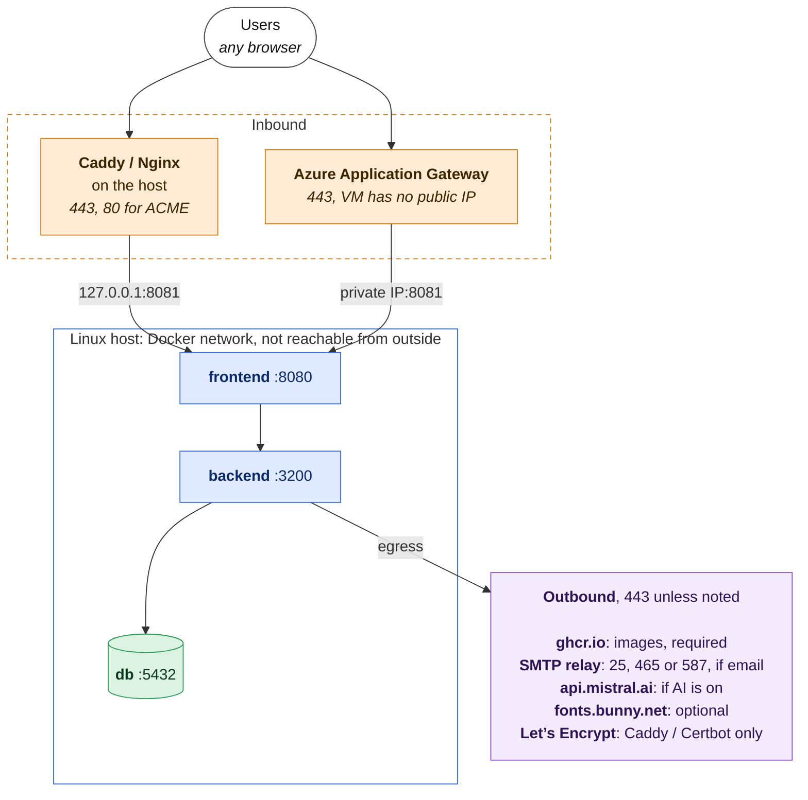

# AFRY LMS — Server & Software Requirements

What to provision **before** following the
[Production Deployment guide](./production-deployment.md). This document is the
target spec for a single-tenant install (SaaS node or on-premise); it does not
cover multi-node HA.

---

## 1. Summary

AFRY LMS runs as **one Linux host** with **Docker Compose**. Four containers, all
pulled from GitHub Container Registry (GHCR) — nothing is built on the server and
no repository access is needed:

| Container | Image | Does | Runs |
|---|---|---|---|
| `afry_lms_frontend` | `frontend` | Nginx: the 5 SPAs, uploaded files, `/api` proxy | always |
| `afry_lms_backend` | `backend` | Node.js 24 / Express REST API | always |
| `afry_lms_db` | `db` | Stock PostgreSQL 18 | always |
| `migrate` | `backend` | Builds the schema, applies new migrations, exits | on every `up` |

Images are `ghcr.io/xavier-follet/afry-lms/<image>`. A **reverse proxy** you provide
terminates TLS: Caddy or Nginx on the host, or Azure Application Gateway in front
of the VM. Sign-in is stateless JWT, so there is **no Redis, session store or
cache tier**. All persistent state lives in **two Docker volumes**.




---

## 2. Host hardware

### CPU architecture

`linux/amd64` (x86-64) **or** `linux/arm64` — the release images are multi-arch.

### Sizing tiers

| Tier | vCPU | RAM | System disk | Data disk (encrypted) | Fits |
|---|---|---|---|---|---|
| **Evaluation / pilot** | 2 | 4 GB | 40 GB | — (single disk OK) | < ~50 concurrent learners, little media |
| **Production, small–medium** | 4 | 8 GB | 40 GB | 100 GB+, growable (LVM) | up to a few hundred concurrent learners |
| **Production, media-heavy / larger** | 8 | 16 GB | 40 GB | sized to content, growable | many orgs, video uploads, frequent SCORM imports |

Sizing rationale:

- The shipped compose resource limits sum to ~2.25 vCPU / ~1.3 GB across all
  containers (see [§8](#8-container-resource-limits)). Add host OS + Docker daemon
  (~1 GB) and PostgreSQL filesystem-cache headroom.
- **Certificate PDF generation runs headless Chromium in-process inside the
  backend container** (Puppeteer). A render can transiently add 150–300 MB. If
  certificates with PDF attachments are used, raise `BACKEND_MEMORY` to **at least
  1 GB** or the container is OOM-killed.
- Image processing (Sharp) and SCORM ZIP extraction (`adm-zip`) are CPU/RAM
  spikes proportional to upload size.

### Disk budget

| Consumer | Size | Notes |
|---|---|---|
| OS + Docker Engine | ~5 GB | |
| Images | ~3–5 GB | Chromium is most of the backend image |
| `postgres_data` volume | MB to low GB | All relational data, SCORM runtime state |
| `uploads_data` volume | **grows without bound** | Images, audio, **video**, unpacked SCORM. Put it on a growable (LVM) disk |
| Local backups | (DB dump + uploads) × 11 | 7 daily + 4 weekly. Prefer `OFFSITE_DEST` and keep few on the host |

Put the two Docker volumes and (optionally) `/srv/backups` on the **encrypted
data disk**, not the system disk.

---

## 3. Operating system

| Requirement | Detail |
|---|---|
| Kernel | 64-bit Linux, **systemd**, **cgroup v2** (without it, resource limits are ignored) |
| Distro | Ubuntu 26.04 LTS recommended. Debian 13 and RHEL / Rocky / Alma 10 work |
| Time sync | `systemd-timesyncd` or `chrony`. Tokens, TLS and certificate dates need it |
| Data disk | A **dedicated block device** for LUKS, set up before the first `up` |
| Users | A non-root user in the `docker` group. `root` only for LUKS, backups, cron |

No swap is required, but a small swap file (1–2 GB) is a reasonable safety margin
on the 4 GB tier.

---

## 4. Required software on the host

Everything the application itself needs is inside the containers. The host only
needs the runtime and operational tooling below.

| Software | Version | For | Install |
|---|---|---|---|
| **Docker Engine** | 24+ | Running the containers | `curl -fsSL https://get.docker.com \| sh` |
| **Docker Compose** | v2 | Orchestration ¹ | Comes with Docker Engine |
| **Reverse proxy** | Caddy 2, or Nginx 1.18+ with Certbot | TLS | `apt`. Not needed with Application Gateway |
| `cryptsetup` | any | LUKS encryption at rest | `apt install cryptsetup` |
| **GnuPG** | 2.x | Encrypting backups | usually preinstalled |
| `rsync` + OpenSSH | any | Offsite backup copy | `apt install rsync` |
| `cron` or systemd timers | | Daily backup + health check | preinstalled |
| **OpenSSL** | any | Generating secrets | preinstalled |
| `tar`, `gzip`, coreutils | any | Backup archives | preinstalled |
| `mailutils` | any | *Optional:* cron failure mail | `apt install mailutils` |
| `gh` or `curl` | any | *Optional:* downloading release files | `apt install gh` |

¹ The old `docker-compose` v1 silently ignores the resource limits. Check with
`docker compose version`.

**Not needed on the host:** Node.js, a PostgreSQL client, `npm`, or any build
toolchain. Use `docker compose exec postgres psql …` when you need a shell to the
database.

---

## 5. Container images (from GHCR)

| Image | Base | Contains | User | Port |
|---|---|---|---|--:|
| `db` | `postgres:18` (Debian) | PostgreSQL 18, nothing added | `postgres` | 5432 |
| `backend` | `node:24-alpine` | Node.js 24, Chromium for PDFs, no `npm` | `node` | 3200 |
| `frontend` | `nginx-unprivileged:1.27-alpine` | Nginx 1.27, the built SPAs | `nginx` (101) | 8080 |

- Backend and frontend run as non-root. All three are built for **`linux/amd64`
  and `linux/arm64`**.
- Every release is **Trivy-scanned**; a HIGH or CRITICAL finding fails the build.
- The frontend has `VITE_API_URL` baked in **at build time** when that CI secret
  is set; a domain change then needs a new release. Left empty, the frontend calls
  `/api` on its own domain and needs nothing rebuilt.

### GHCR authentication

One-time, on the host:

```bash
echo YOUR_TOKEN | docker login ghcr.io -u afry-lms-customer --password-stdin
```

The token is supplied by the AFRY LMS team; any non-empty username works. Docker caches
the credential in `~/.docker/config.json`.

### Air-gapped hosts

Transfer images with `docker save` / `docker load` instead of `docker login` +
`pull`. Set `EXTERNAL_FONTS=off`, leave AI unconfigured, and point SMTP at an
internal relay — see [§6](#6-networking) and
[production-deployment.md](./production-deployment.md#air-gapped-and-no-egress-installs).

---

## 6. Networking

### Inbound (host firewall)

| Port | From | For | When |
|---|---|---|---|
| 443 | Internet | HTTPS | Always (on the gateway, with Application Gateway) |
| 80 | Internet | ACME challenge, HTTPS redirect | Caddy or Certbot with HTTP-01 |
| 8081 | Application Gateway subnet | Gateway to app | Application Gateway only |
| 22 | Admin IPs | SSH | Recommended, source-restricted |

The app is published **only on `127.0.0.1:APP_PORT`**: never bind it to
`0.0.0.0`. With Application Gateway, add a second binding on the VM's **private**
IP (see [Option C](./production-deployment.md#option-c--azure-application-gateway));
the VM then needs no public IP. Ports 3200 and 5432 stay on the Docker network.

### Outbound

| Destination | Port | For | When |
|---|--:|---|---|
| `ghcr.io`, `pkg-containers.githubusercontent.com` | 443 | Images and updates | Always, unless side-loaded |
| `github.com`, `*.githubusercontent.com` | 443 | Release files (compose file, scripts) | Install and updates; or copy them over by hand |
| `acme-v02.api.letsencrypt.org` | 443 | TLS certificates | Caddy or Certbot |
| Your SMTP relay | 25, 465, 587 | Email | If notifications are used |
| `api.mistral.ai` | 443 | Maestro, the AI agent | If AI is on |
| `fonts.bunny.net` | 443 | Author-chosen web fonts | Unless `EXTERNAL_FONTS=off` |
| NTP | 123/udp | Clock sync | Always |

The product's own UI fonts are always served from the host.

### Internal

- One Docker bridge network (Compose default). Service DNS names: `postgres`,
  `backend`, `frontend`.
- `POSTGRES_HOST=postgres` is hardcoded in `docker-compose.yml` — it is not an
  env var you set.

---

## 7. TLS & reverse proxy

- **Terminated at the reverse proxy.** The frontend and backend containers
  speak plain HTTP on loopback / the bridge only.
- Forward to `http://127.0.0.1:${APP_PORT}` (default 8081 — left off 80 so the reverse proxy itself can bind port 80).
  Application Gateway forwards to the VM's private IP on the same port instead.
- Set `client_max_body_size 200M` (or the proxy equivalent) — matches the Nginx
  limit inside the frontend container for uploads. On Application Gateway that is
  the WAF file upload limit, if the WAF is enabled.
- Allow a **120 s** upstream timeout — matches the frontend's Nginx. Application
  Gateway's default backend timeout is 20 s, too short for SCORM imports and AI calls.
- `TRUST_PROXY` (default `2`) counts the proxies in front of the backend: your
  reverse proxy plus the frontend's Nginx. Raise it by one per extra layer (a CDN,
  Azure Front Door), or the login log and IP rate limit see a proxy instead of the user.
- Recommended: TLS 1.2+ only, HSTS, OCSP stapling, HTTP-to-HTTPS redirect.
- `CORS_ORIGIN` and `PORTAL_BASE_URL` must be the **exact** public `https://`
  origin (scheme + host, no trailing slash).

Caddy config is a two-line `Caddyfile`; Nginx + Certbot config and the Application
Gateway settings are in
[production-deployment.md](./production-deployment.md#reverse-proxy--https).

---

## 8. Container resource limits

Overridable from `.env`; defaults shipped in `docker-compose.yml`:

| Container | CPUs | Memory | Override in `.env` |
|---|--:|--:|---|
| `afry_lms_db` | 1.0 | 512M | `POSTGRES_CPUS` · `POSTGRES_MEMORY` |
| `afry_lms_backend` | 1.0 | 512M | `BACKEND_CPUS` · `BACKEND_MEMORY` |
| `afry_lms_frontend` | 0.25 | 64M | `FRONTEND_CPUS` · `FRONTEND_MEMORY` |
| `migrate` | 0.5 | 256M | `MIGRATE_CPUS` · `MIGRATE_MEMORY` |

**Calibrate before relying on them.** Run a representative load (concurrent
learners + a large SCORM import + a certificate issuance) and watch
`docker stats`. An OOM shows as `OOMKilled` in `docker compose ps`. In
particular, **`BACKEND_MEMORY=512M` is too low when certificate PDFs are
enabled** — set `1G` or higher.

Requires Compose v2 + cgroup v2, or the limits are ignored.

---

## 9. Persistent data & backup

| Volume | Mounted in | Holds |
|---|---|---|
| `afry_lms_postgres_data` | `db` | All relational data, **SCORM runtime state**, file metadata |
| `afry_lms_uploads_data` | `backend` (read-write), `frontend` (read-only) | Images, audio, video, unpacked SCORM, in `public/` and `private/` |

- A complete backup is **both** halves taken together — the DB stores UUIDs, the
  volume stores the blobs. Neither restores alone.
- Backups are **GPG (AES-256) encrypted** (they contain PII). Passphrase in
  `/root/.backup-passphrase` (mode 600); keep a copy in a password manager.
- Default schedule: daily `pg_dump` + uploads `tar` at 03:00, healthcheck 04:30,
  via `cron`. Retention 7 daily + 4 weekly. Optional `OFFSITE_DEST` (rsync/SSH).
- Current targets: **RPO 24 h, RTO 2–4 h**. Revisit at first paying tenant.

Full procedure: [backup-and-recovery.md](./backup-and-recovery.md).

### Encryption at rest

Point Docker's `data-root` at a **LUKS-encrypted mount before the first
`docker compose up`**. Otherwise PII in the database and uploads is readable by
anyone with disk or root access. See
[production-deployment.md](./production-deployment.md#encryption-at-rest).

---

## 10. Secrets to generate or provide

Stored in `/srv/<deploy-dir>/.env` (mode 600, root-owned).

| Variable | Generate | Changing it later |
|---|---|---|
| `POSTGRES_PASSWORD` | strong random | `rotate-secret.sh POSTGRES_PASSWORD` changes the DB role and `.env` together |
| `JWT_SECRET` | `openssl rand -hex 32` | `rotate-secret.sh`: nobody is signed out; finish after 7 days |
| `FILE_TOKEN_SECRET` | `openssl rand -hex 32` | `rotate-secret.sh`: open links keep working; finish after 13 hours |
| `SCORM_CONTEXT_SECRET` | `openssl rand -hex 32` | `rotate-secret.sh`: running courses keep tracking; finish after 1 hour |
| `SMTP_ENCRYPTION_KEY` | `openssl rand -hex 32` | `rotate-secret.sh` re-encrypts stored SMTP passwords and AI keys. Replacing it without keeping the old value as `SMTP_ENCRYPTION_KEY_PREVIOUS` loses them |
| `SUPERADMIN_EMAIL` / `_PASSWORD` | choose | First run only. Remove the password afterwards |
| Backup passphrase | strong random | Keep the old one for as long as the backups it encrypted are retained |

Procedures, recommended cadence and the leaked-secret checklist:
[Rotating secrets](./production-deployment.md#rotating-secrets). The backend refuses to
start on a placeholder, short or malformed secret, or the default database password.

Other required non-secret vars: `GITHUB_REPOSITORY`, `CORS_ORIGIN`,
`PORTAL_BASE_URL`, `APP_VERSION` (pin to a tag). Full reference:
[production-deployment.md](./production-deployment.md#environment-variables) and
`env.prod.example`.

---

## 11. External services (not on the host)

| Service | For | Notes |
|---|---|---|
| **DNS** | Reaching the app | A / AAAA record to the host, or to Application Gateway |
| **SMTP relay** | Email notifications | Per organization or system-wide, entered in the app |
| **Mistral AI** | Maestro | Optional |
| **Offsite backup target** | Disaster recovery | Any rsync-over-SSH path |
| **GHCR** | Images | The pull token from the AFRY LMS team |

---

## 12. Scaling & availability constraints

Design the capacity plan around **one backend instance**:

- The backend runs an **in-process hourly `node-cron` scheduler** (certificate
  expiry notifications). A second backend replica sends duplicate emails.
- **Puppeteer / Chromium runs in-process** in the backend container.
- The uploads volume is a **local** `RWX`-style mount shared between backend and
  frontend — it assumes a single host.
- **Scale vertically**: raise host CPU/RAM and the `BACKEND_*` / `POSTGRES_*`
  limits. Do not add backend replicas.
- PostgreSQL is a single container with no built-in replication. For a managed /
  replicated database, point `POSTGRES_HOST` at an external PostgreSQL 18 and
  drop the `db` service — not covered by these docs.

---

## 13. Monitoring & operations

| Check | How |
|---|---|
| Liveness | `curl localhost:8081/api/version`, or `/health` inside the backend container |
| Version | `/api/version` returns the app version and the applied migration |
| Crashes, OOM | `docker compose ps -a`, `docker inspect` (`OOMKilled`) |
| Logs | `docker compose logs` (JSON). Cap the Docker log driver so logs cannot fill the disk |
| Resource use | `docker stats` |
| Updates | `docker compose pull && docker compose up -d`; `migrate` runs first |
| Backups | cron + `scripts/backup-healthcheck.sh` |

---

## 14. Pre-flight checklist

- [ ] Linux host, systemd + cgroup v2, 64-bit, sized per [§2](#2-host-hardware)
- [ ] Docker Engine 24+ and Compose v2 (`docker compose version`)
- [ ] Dedicated data disk: LUKS-formatted, mounted, Docker `data-root` repointed — **before first `up`**
- [ ] DNS A/AAAA record resolves to the host (or to the Application Gateway)
- [ ] Firewall: 443 inbound; 80 inbound only if using ACME HTTP-01; 22 source-restricted; app port **not** public (with Application Gateway: app port open to the gateway subnet only)
- [ ] Reverse proxy installed and forwarding to `127.0.0.1:APP_PORT`, or Application Gateway configured (120 s timeout, `/api/version` probe)
- [ ] `TRUST_PROXY` matches the number of proxies (default `2`)
- [ ] Outbound egress allowed to `ghcr.io` and `github.com` (+ Let's Encrypt / SMTP / Mistral / `fonts.bunny.net` as applicable)
- [ ] Pull token received from the AFRY LMS team; `docker login ghcr.io` done
- [ ] `.env` completed; `JWT_SECRET`, `FILE_TOKEN_SECRET`, `SCORM_CONTEXT_SECRET`, `SMTP_ENCRYPTION_KEY`, `POSTGRES_PASSWORD` generated; file `chmod 600`
- [ ] `APP_VERSION` pinned to a release tag
- [ ] `/root/.backup-passphrase` set (mode 600); `/srv/backups` created; `OFFSITE_DEST` reachable
- [ ] `BACKEND_MEMORY` raised to `1G`+ if certificate PDFs will be used
- [ ] SMTP relay details ready (if notifications); Mistral key ready (if AI)
- [ ] NTP / time sync running

---

## See also

- [Production Deployment](./production-deployment.md) — step-by-step install
- [Backup & Recovery](./backup-and-recovery.md) — DR runbook
- [../font-policy.md](../font-policy.md) — the `EXTERNAL_FONTS` decision
